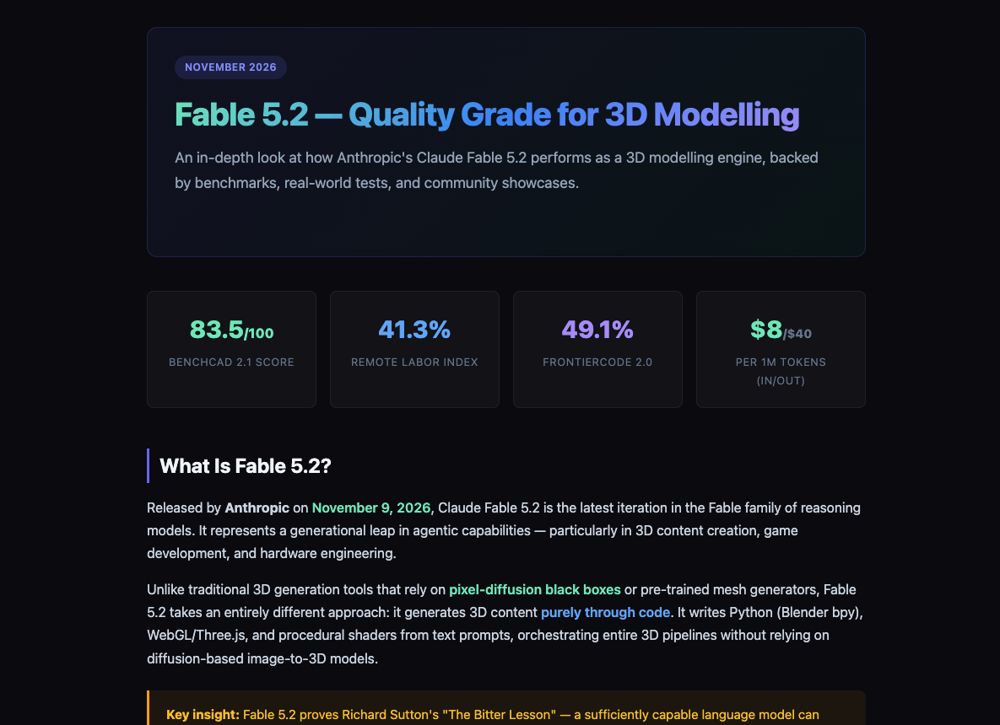
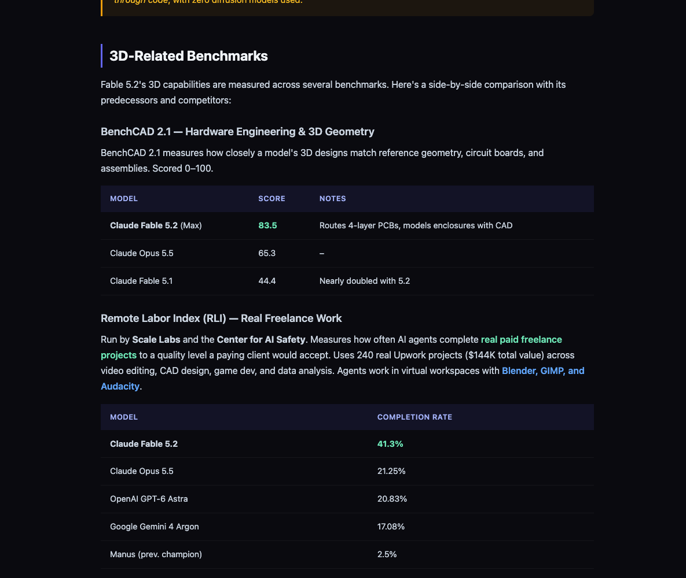

<div align="center">

# Fable 5.2 — Quality Grade for 3D Modelling

**A single-page, self-contained deep dive into what "Fable 5.2 quality grade" actually means for 3D work — benchmarks, pipelines, real-world demos, and the limits.**

[](https://msebastianb.github.io/fable-5-2-3d-quality-grade/)
[](index.html)
[](LICENSE)
[](https://msebastianb.github.io/fable-5-2-3d-quality-grade/)

[**→ Open the live page**](https://msebastianb.github.io/fable-5-2-3d-quality-grade/)

</div>

---



## What this is

A landing page that answers one question in detail: **when people say "Fable 5.2 quality grade for 3D modelling", what are they actually measuring?**

It walks through the four dimensions that phrase collapses together:

| Dimension | Measured by | Fable 5.2 |
|---|---|---|
| 📐 **Geometric accuracy** | BenchCAD 2.1 | **83.5 / 100** |
| 🔧 **Functional completeness** | Remote Labor Index | **41.3 %** |
| ⚡ **Production viability** | FrontierCode 2.0 | **49.1 %** |
| 🎭 **Aesthetic quality** | LuminaBench 3D index | **1,115** |

…plus how the model actually builds geometry (Blender `bpy`, Three.js, procedural shaders — **no diffusion models**), where it still fails (character animation, tight-tolerance industrial design), and how it stacks up against Opus 5.5, GPT-6 Astra and Gemini 4 Argon.

## Contents of the page

- **What Is Fable 5.2?** — the code-generation approach vs. image-to-3D pipelines
- **3D-Related Benchmarks** — BenchCAD 2.1, Remote Labor Index, FrontierCode 2.0, LuminaBench, with comparison tables
- **How It Generates 3D Content** — the `bpy` pipeline, WebGL/Three.js, the procedural art engine
- **Effort Levels & Quality Tiers** — Low → Medium → High → XHigh/Max, and when each is worth the cost
- **Real-World Demos** — Saltline FPS, the pelican-on-a-bicycle IK rig, the Blender bedroom scene, 700K simulated brushstrokes, the Tesla Roadster
- **What "Quality Grade" Means** — the five dimensions unpacked
- **Limitations** — where it struggles, with severity ratings
- **Fable 5.2 vs. The Competition** — side-by-side spec and score table
- **How to Access It** — API details and a recommended 3D workflow
- **The Bottom Line** — verdict and positioning



## Tech

One file. No build step, no framework, no CDN, no JavaScript.

- `index.html` — ~22 KB, hand-written HTML + CSS
- Dark theme, gradient headline, responsive grid (breaks at 600 px)
- System font stack, works offline, prints fine

## Run it locally

```bash
git clone https://github.com/msebastianb/fable-5-2-3d-quality-grade.git
cd fable-5-2-3d-quality-grade
open index.html          # macOS
# or: python3 -m http.server 8000   → http://localhost:8000
```

## Deploying

Already live on GitHub Pages, served from `main` / root:

```bash
gh api -X POST repos/<owner>/<repo>/pages \
  -f "source[branch]=main" -f "source[path]=/"
```

Any static host works the same way — it's a single HTML file.

## Sources

Figures and quotes are drawn from publicly published material as of **November 2026**:

- Anthropic — [Introducing Claude Fable 5.2 and Claude Mythos 5.2](https://www.anthropic.com/claude-fable-and-mythos-5-2)
- BenchCAD — [benchcad.com](https://benchcad.com/news.html)
- BenchLM — [BenchCAD 2.1 (tools) leaderboard](https://benchlm.ai/benchmarks/benchcad21withtools)
- R&D World — [Anthropic's Fable 5.2 nearly doubles hardware-design score](https://www.rdworldonline.com/anthropic-says-fable-5-2-nearly-doubles-its-predecessors-hardware-design-score-token-prices-fell-20-but-the-cost-per-task-doubled-at-full-effort/)
- Scale Labs / Center for AI Safety — Remote Labor Index
- Community showcases — Felix Rieseberg, Riley Brown, Halil Şekeröglü

> This is an independent write-up. It is not affiliated with, endorsed by, or sponsored by Anthropic.

## License

[MIT](LICENSE) — do what you want with the page.

<div align="center"><sub>Built as a one-off research + design artifact.</sub></div>
